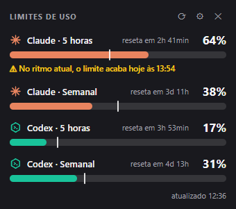
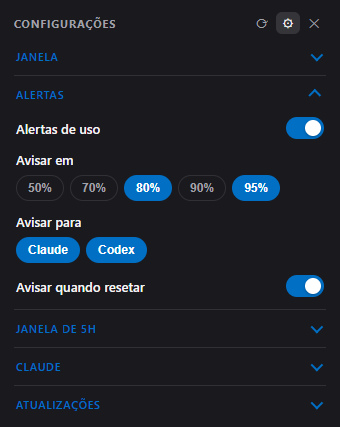
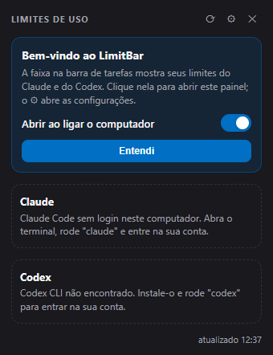

# LimitBar

**Seus limites de 5 horas e semanal do Claude e do Codex, sempre visíveis na barra de tarefas do Windows.**

Uma faixa pequena sobre a barra de tarefas mostra quanto você já usou de cada janela. Um clique abre um painel colado na barra com barras de progresso, tempo até o reset e ritmo de consumo.

<p align="center">
  
</p>

<table align="center">
  <tr>
    <td align="center" valign="top"><br><sub><b>Painel</b></sub></td>
    <td align="center" valign="top"><br><sub><b>Configurações</b> (⚙)</sub></td>
    <td align="center" valign="top"><br><sub><b>Primeiro uso</b></sub></td>
  </tr>
</table>

<sub>Os números das capturas são ilustrativos.</sub>

## Recursos

- **Faixa na barra de tarefas** com Claude e Codex (5h e semanal). Âmbar a partir de 70%, vermelho com ⚠ a partir de 90%; a borda acompanha a pior janela. Arraste pela alça `⋮⋮` para posicionar.
- **Painel** com barras de progresso, marcador de ritmo (onde você *deveria* estar) e horário do reset ao passar o mouse.
- **Previsão de esgotamento**: "no ritmo atual, o limite acaba hoje às 14:32".
- **Alertas do Windows** configuráveis (50 a 95%, aviso de reset, silenciar por serviço).
- **Tema** Sistema, Claro ou Escuro, com fundo acrílico do Windows 11.
- **Atualização com um clique**, com conferência SHA-256.
- **Janela de 5h automática** (opcional, desligada por padrão): veja [abaixo](#janela-de-5h-automática-opcional).
- **Renovação automática do login do Claude** (pode ser desligada).
- **Iniciar com o Windows** e mensagens de primeiro uso que dizem o que fazer se faltar o Claude Code ou o Codex.
- Acessível: teclado (`Esc`, `F5`, `Ctrl+,`), leitores de tela, contraste verificado por teste e sem animações se o Windows pedir.

## Requisitos

- Windows 11
- Claude Code e/ou Codex CLI instalados e logados no mesmo usuário do Windows
- [Node.js](https://nodejs.org) 18+ (só para instalar a partir do código)

## Instalação

**Pronto, sem Node.js:** baixe o `LimitBar-win32-x64.zip` na [página de Releases](https://github.com/igorfggomes/limitbar/releases/latest), extraia e abra o `LimitBar.exe`. O executável não é assinado, então o SmartScreen pode avisar: **Mais informações → Executar assim mesmo**.

**A partir do código** (cria atalhos e instala em `%LOCALAPPDATA%\Programs\LimitBar`):

```powershell
git clone https://github.com/igorfggomes/limitbar.git
cd limitbar
powershell -ExecutionPolicy Bypass -File instalar.ps1
```

**Rodar direto do código:** `npm install` e `npm start`.

## Uso

| Ação | Resultado |
|---|---|
| Clique na faixa | Abre ou fecha o painel |
| ⚙ no painel | Configurações: tema, alertas, janela de 5h, login do Claude, atualizações |
| Clique direito na faixa | Menu: atualizar, minimizar ao fechar, manter aberto, iniciar com o Windows, sair |
| Arrastar `⋮⋮` | Move a faixa (posição salva) |

## Como funciona

| Serviço | De onde vêm os dados |
|---|---|
| **Claude** | O token do Claude Code (`~/.claude/.credentials.json`) consulta o endpoint de uso do `/usage`. |
| **Codex** | Os logs de sessão em `~/.codex/sessions` (`rate_limits`). Só atualiza depois que você usa o Codex. |

O token vai apenas para a Anthropic (`api.anthropic.com` e, para renovar, `platform.claude.com`) e nunca é registrado em log nem copiado para outro lugar. O app consulta no máximo a cada 2,5 minutos, respeita o `Retry-After` do HTTP 429 e, em falhas, mantém o último valor bom.

**Renovação do login.** Os tokens de renovação do Claude são rotativos. Se o token expirou, o LimitBar renova e **grava o resultado no arquivo de login do Claude Code**, só se o token no disco ainda for o que ele usou (se o Claude Code renovou antes, nada é sobrescrito), de forma atômica e sem insistir por 10 minutos se o servidor recusar. Para o LimitBar nunca escrever nesse arquivo, desligue **Renovar o login sozinho** em ⚙ → Claude.

> **Aviso:** ferramenta não oficial, sem vínculo com a Anthropic ou a OpenAI. O endpoint de uso do Claude e o formato dos logs do Codex não são APIs públicas e podem mudar sem aviso.

## Janela de 5h automática (opcional)

As janelas de 5 horas só começam na primeira mensagem. Com **⚙ → Janela de 5h → Iniciar a janela sozinho**, o LimitBar detecta uma janela parada e envia **uma mensagem mínima** pela CLI oficial para a próxima começar. Vale para Claude e Codex, à sua escolha.

Não aumenta o seu limite: só muda *quando* as janelas começam, e cada disparo gasta um pouco do limite semanal. Confira os termos do seu plano sobre uso automatizado. Quem usa chave de API (e não assinatura) não deve ligar.

| Serviço | Comando |
|---|---|
| Claude | `claude -p "Responda apenas: ok" --model haiku --no-session-persistence --tools ""` |
| Codex | `codex exec --skip-git-repo-check -s read-only "Responda apenas: ok"` |

Roda numa pasta temporária vazia, sem variáveis de chave de API, e nunca chama a API direto com o seu token.

- **Teto de custo** (1, 2, 3 ou 5%; padrão 2%): depois de cada disparo o uso é lido de novo; se o custo passar do teto, a função é desligada para aquele serviço e você é avisado. A leitura tem resolução de 1 ponto percentual e inclui outro uso seu no mesmo instante, então o custo pode sair um pouco inflado.
- **Travas**: só dispara com a janela comprovadamente parada (leitura duvidosa nunca dispara); espera 1 minuto após abrir o app e 12 após um disparo; falhas aumentam a espera (10 a 120 min); no máximo 3 tentativas por janela parada e 8 por dia, por serviço.
- **Testar agora** envia uma mensagem a cada serviço marcado (com confirmação) e mostra o custo medido.
- **Validação**: nos dois serviços, em uso real, os comandos terminaram com sucesso e o custo ficou entre 0% e 1%. No Codex a criação de uma janela nova foi observada; no Claude, não foi isolada (a janela já estava ativa).

## Atualizações

O LimitBar consulta as [Releases](https://github.com/igorfggomes/limitbar/releases) ao abrir e a cada 6 horas. Havendo versão nova, aparece um **⬆** na faixa; **Atualizar agora** baixa o zip, confere o SHA-256, troca os arquivos e reabre o app. Se algo falhar, a versão atual é mantida e suas configurações não são tocadas. Funciona no app empacotado em pasta com permissão de escrita; nos demais casos, abre a página da Release. Dá para procurar na hora (⚙) ou desligar a verificação automática (menu da faixa).

## Limitações

- A faixa é uma janela posicionada sobre a barra de tarefas (o Windows 11 não permite desenhar dentro dela) e é reerguida quando a barra vem para a frente.
- Testado em um monitor, com a barra embaixo.

## Desenvolvimento

```powershell
npm install
npm test        # testes automáticos
npm run test:ui # verificações da interface num Electron oculto
npm start
```

O GitHub executa os testes a cada `push` e `pull request` (Node 20 e 24).

**Publicar uma versão:** aumente `version` no `package.json`, acrescente `## X.Y.Z` no `CHANGELOG.md`, faça o commit e rode `git tag vX.Y.Z && git push origin main vX.Y.Z`. O fluxo **Release** roda os testes, empacota e publica o zip com o `.sha256` e as notas do CHANGELOG. Tags com hífen (`v1.4.0-beta.1`) saem como pré-lançamento e não são oferecidas pela atualização automática.

## Licença

[MIT](LICENSE)
