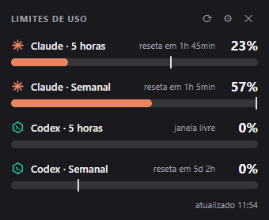

# LimitBar

**Seus limites de 5 horas e semanal do Claude e do Codex, sempre visíveis na barra de tarefas do Windows.**

LimitBar é uma faixa pequena que fica sobre a barra de tarefas mostrando quanto você já usou de cada janela de limite. Um clique abre um painel colado na barra com os detalhes: barras de progresso, tempo até o reset e ritmo de consumo.

<p align="center">
  
</p>

Clique na faixa e o painel abre colado na barra:

<table align="center">
  <tr>
    <td align="center"><br><sub>Barras de uso</sub></td>
    <td align="center"><br><sub>Configurações (botão ⚙)</sub></td>
  </tr>
</table>

## Recursos

- **Faixa na barra de tarefas** com as quatro porcentagens (Claude 5h / semanal, Codex 5h / semanal). Arraste pela alça `⋮⋮` para posicioná-la.
- **Painel que abre colado na barra**, ancorado na faixa, e fecha ao clicar fora (ou fica fixo, se preferir).
- **Barras de progresso** que mudam de cor: normal, amarelo a partir de 70% e vermelho a partir de 90%.
- **Marcador de ritmo** em cada barra: mostra onde você *deveria* estar naquele ponto da janela. Passando o mouse, aparecem o horário do reset e a projeção de uso até lá.
- Tema claro/escuro automático e fundo de vidro (acrílico) do Windows 11.
- **Notificações** ao passar de 80% e de 95% de qualquer janela.
- **Atualização com um clique**: o app avisa quando sai uma versão nova (um ⬆ na faixa e um aviso no painel) e atualiza sozinho.
- **Iniciar com o Windows** pelo menu (clique direito na faixa).

## Como funciona

LimitBar não usa nenhuma conta ou chave sua além do que as próprias ferramentas já guardam no seu computador:

| Serviço | De onde vêm os dados |
|---|---|
| **Claude** | O token do Claude Code (`~/.claude/.credentials.json`) é usado para consultar o endpoint de uso que alimenta o comando `/usage`. |
| **Codex** | Os logs de sessão em `~/.codex/sessions`, que registram `rate_limits` a cada resposta. Só atualiza depois que você usa o Codex. |

O token do Claude é lido em memória, enviado apenas para `api.anthropic.com` e nunca é gravado nem registrado em log.

O endpoint do Claude limita consultas (HTTP 429). Por isso o app consulta no máximo a cada 2,5 minutos, respeita o `Retry-After` e, em qualquer falha, mantém o último valor bom na tela em vez de mostrar erro.

> **Aviso:** esta é uma ferramenta não oficial, sem vínculo com a Anthropic ou a OpenAI. O endpoint de uso do Claude e o formato dos logs do Codex não são APIs públicas e podem mudar sem aviso.

## Requisitos

- Windows 11 (usa o fundo acrílico e a barra de tarefas do 11)
- [Node.js](https://nodejs.org) 18 ou superior (só para instalar a partir do código; o zip da Release não precisa)
- Claude Code e/ou Codex CLI já instalados e logados no mesmo usuário do Windows

## Instalação

### Baixar pronto (mais fácil, sem Node.js)

1. Baixe o `LimitBar-win32-x64.zip` na [página de Releases](https://github.com/igorfggomes/limitbar/releases/latest).
2. Extraia em qualquer pasta e abra o `LimitBar.exe`.

O executável não é assinado digitalmente, então o Windows pode mostrar o aviso do SmartScreen: clique em **Mais informações → Executar assim mesmo**.

### Instalar a partir do código (cria atalhos)

```powershell
git clone https://github.com/igorfggomes/limitbar.git
cd limitbar
powershell -ExecutionPolicy Bypass -File instalar.ps1
```

O script empacota o app, instala em `%LOCALAPPDATA%\Programs\LimitBar` e cria atalhos na Área de Trabalho e no Menu Iniciar. Depois é só abrir o **LimitBar** como qualquer programa (o Node.js só é necessário para essa etapa). Para abrir junto com o Windows, clique com o botão direito na faixa e marque "Iniciar com o Windows".

Para atualizar, use o aviso dentro do app (veja [Atualizações](#atualizações)) ou rode o `instalar.ps1` de novo.

### Rodar direto do código

```powershell
npm install
npm start
```

Para abrir sem janela de console, dê dois cliques em `iniciar.vbs`.

## Uso

| Ação | Resultado |
|---|---|
| Clique na faixa | Abre ou fecha o painel de detalhes |
| Botão ⚙ do painel | **Minimizar ao fechar** (o ✕ só esconde o painel, padrão) e **Procurar atualizações** |
| Clique direito na faixa | Menu: atualizar, minimizar ao fechar, manter aberto, iniciar com o Windows, procurar atualizações, sair |
| Arrastar a alça `⋮⋮` | Move a faixa na horizontal (a posição é salva) |
| Mouse sobre uma barra | Horário do reset, ritmo esperado e projeção |

## Atualizações

O LimitBar consulta as [Releases do GitHub](https://github.com/igorfggomes/limitbar/releases) ao abrir e a cada 6 horas. Quando há versão nova:

1. aparece um **⬆** na faixa e um aviso no painel, além de uma notificação do Windows;
2. clique em **Atualizar agora**: o app baixa o zip, confere o **SHA-256** publicado pelo GitHub, troca os arquivos e **reabre sozinho** (leva cerca de meio minuto);
3. **Depois** dispensa o aviso daquela versão.

Se algo falhar (download, arquivo corrompido, troca de arquivos), a versão atual é mantida. Pelo botão **⚙** do painel ou pelo menu da faixa (clique direito) você pode **procurar atualizações** na hora; no menu também dá para **desligar a verificação automática**. Suas configurações não são tocadas.

A atualização com um clique funciona no app empacotado e instalado em uma pasta onde você pode gravar (como `%LOCALAPPDATA%ProgramsLimitBar` ou a pasta onde extraiu o zip). Em outros casos, o botão abre a página da Release para você baixar manualmente.

## Limitações

- A barra de tarefas do Windows 11 não permite que apps comuns desenhem dentro dela, então a faixa é uma janela posicionada por cima. O app a reergue sempre que o Windows põe a barra na frente.
- Testado em um monitor, com a barra de tarefas embaixo. Barra no topo ou nas laterais é tratada, mas pouco testada.
- Os dados do Codex só mudam depois de você usá-lo.

## Estrutura

```
main.js        processo principal: janelas, faixa, flyout, alertas
providers.js   leitura dos dados do Claude e do Codex
index.html     painel (barras de uso e configurações)
dock.html      faixa sobre a barra de tarefas
preload.js     ponte segura entre a interface e o processo principal
updater.js     atualização automática (consulta, download, verificação, troca de arquivos)
instalar.ps1   instala como programa (exe + atalhos)
build/         ícone e script de empacotamento
```

## Licença

[MIT](LICENSE)
